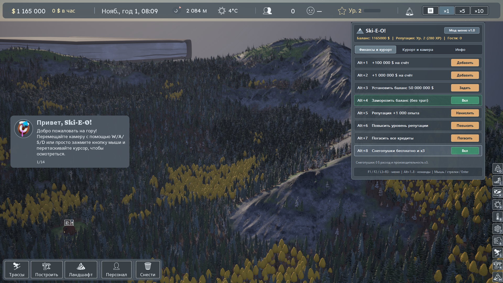
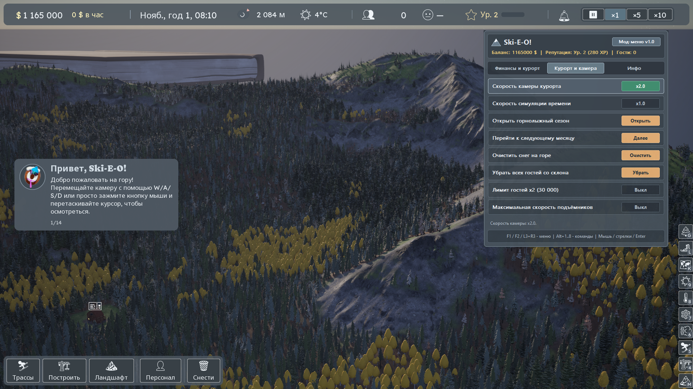
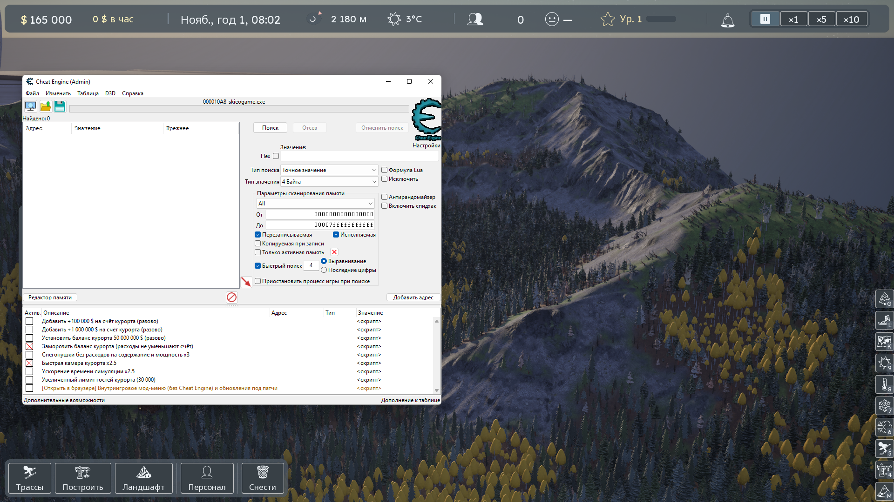

# Ski-E-O! Ski Resort Tycoon - Мод-меню, сохранение и таблица .CT

Старт с бюджетом `5 000 000 $`, заморозка счёта, репутация курорта, бесплатные снегопушки `x3` и быстрая камера + таблица `.CT` (`v1.0`, сборка `CL7848`, Windows и Steam Deck).

## Скачать
- **[Полное мод-меню v1.0 на Boosty (ранний доступ до 28 ноября от 120 ₽, далее открыто всем)](https://boosty.to/cd_tixo/posts/4f0cee8e-4c79-4c4c-826f-5caef2db29e9?utm_source=github&utm_medium=readme&utm_campaign=ski_e_o)**
- **[Таблица .CT и стартовое сохранение на GitHub Releases](https://github.com/neoru-droid/ski-e-o-mod-ru/releases)**
- **Заказ своей игры:** в очередь - `350 ₽`, вне очереди - `750 ₽` на [Boosty](https://boosty.to/cd_tixo?utm_source=github&utm_medium=readme&utm_campaign=order_game)

## Установка
1. **Windows:** закройте игру, распакуйте `SkiEO-Trainer-RU-v1.0.zip` и запустите `SkiEO-Trainer-Setup.exe` -> **«Установить мод-меню»**.
2. **Steam Deck / Linux (Proton):** распакуйте архив и выполните `sh install-steamdeck.sh`.
3. **В игре:** `F1` / `F2` или `L3 + R3` открывает окно. Удаление - кнопка в установщике или `sh install-steamdeck.sh --uninstall`.

## Функции мод-меню

- **Финансы и курорт:** `Alt+1` `+100 000 $`, `Alt+2` `+1 000 000 $`, `Alt+3` баланс `50 000 000 $`, `Alt+4` заморозка баланса, `Alt+5` `+1 000` репутации, `Alt+6` уровень репутации, `Alt+7` погасить кредиты, `Alt+8` бесплатные снегопушки `x3`.
- **Курорт и камера:** скорость камеры (`x2.0 / x3.5`), скорость симуляции (`x2.0 / x4.0`), открыть сезон, следующий месяц, очистка снега, убрать гостей, лимит гостей `x2` (`30 000`) и быстрые подъёмники.

## Таблица .CT и стартовое сохранение

- **Таблица (`SkiEO-CheatTable-RU-v1.0.zip`):** 8 основных функций для `skieogame.exe` в Cheat Engine 7.5+.
- **Сохранение (`SkiEO-Save-v1.0.zip`):** курорт со стартовым бюджетом `5 000 000 $` -> распаковать `SaveGames` в `%LOCALAPPDATA%\Ski-E-O\SaveGames`.

Нашли баг после патча - пишите в [Issues](https://github.com/neoru-droid/ski-e-o-mod-ru/issues).

[Сайт каталога](https://neoru-droid.github.io/) · [Каталог на Boosty](https://boosty.to/cd_tixo/posts/2a55d7e9-0f53-4d93-9f66-280981158dec?utm_source=github&utm_medium=readme&utm_campaign=ski_e_o) · [GitHub](https://github.com/neoru-droid) · [MIT](LICENSE) · Автор: `neoru-droid`
